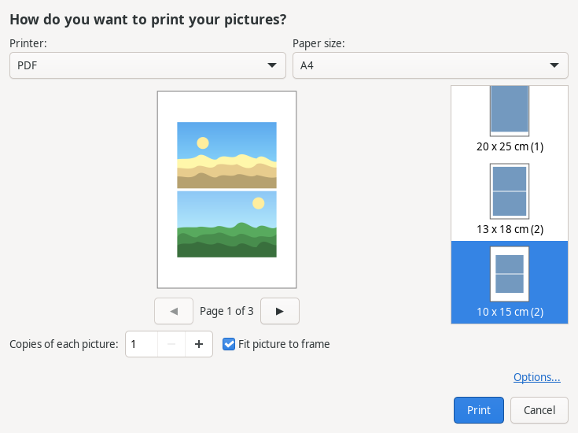

# Print Pictures

The "Print Pictures" window from Windows, for Linux: select photos, right-click,
**Print**, pick a layout, **Print**.



> **Early preview.** It has not yet been tried on many computers or printers.
> Print one page and measure it before printing a large batch, and
> [tell us what happens](https://github.com/MihleDex/print-pictures/issues).

## What it does

- The Windows layouts: full page photo, 20 x 25, 13 x 18, 10 x 15 and
  9 x 13 cm, wallet, and contact sheet. Where the system uses Letter paper you
  get 8 x 10, 5 x 7, 4 x 6 and 3.5 x 5 inches instead.
- A preview of every page, copies of each picture, "Fit picture to frame", and
  sharpening for printing.
- Remembers your printer, paper and layout.
- Works with the printers set up on your computer. With a printer that makes PDF
  files, it asks where to save.
- Turns phone photos the right way up. Opens JPEG, PNG, HEIC, WebP, TIFF, BMP
  and GIF.

## Download and install

For Linux Mint 22, Zorin OS 18, Ubuntu (also Kubuntu and Xubuntu) 24.04, Debian
13, or newer, on an ordinary 64-bit PC.

1. Open the [releases page](https://github.com/MihleDex/print-pictures/releases)
   and download the file ending in `.deb`. If the page is empty, the first
   preview is still being tested.
2. Double-click the downloaded file and choose **Install**.
3. Close your file manager and open it again.

## How to use it

1. In your file manager, select one or more pictures.
2. Right-click them and choose **Print**.
3. Pick the printer, paper size and layout, and check the preview.
4. Press **Print**.

**Xfce (Thunar):** once, open **Print Pictures** from the applications menu and
press **Add Print to the right-click menu**.

**Another file manager:** right-click the pictures, then **Open With → Print
Pictures**.

## Coming from Windows

The window, the layouts and "Fit picture to frame" work as you remember. What
differs:

- The right-click entry is called **Print**.
- Sizes are metric unless your system is set to Letter paper.
- **Options... → Printer Properties...** is a plain list of your printer's
  settings, not the maker's own window.
- There is no "Color management" button.
- To make PDF files, install a PDF printer (the `printer-driver-cups-pdf`
  package) and choose it; **Print** then asks where to save.

## Help

**There is no "Print" when I right-click.** Close the file manager completely, or
log out and in again. On Xfce, add it as described above. "Print" only appears
when everything selected is a picture. "Open With → Print Pictures" always works.

**Double-clicking the downloaded file does not install it.** Open a terminal in
the folder it is in and run `sudo apt install ./print-pictures_*.deb`.

**I installed it from source before.** The old copy runs instead of the new one.
Remove it first: `~/.local/bin/print-pictures uninstall`

**My printer is not in the list.** Add it in your system's printer settings, then
open Print Pictures again.

**It prints at the wrong size.** Check that the paper size in the window matches
the paper in the printer. If it does, please report it with your printer's model.

**A picture prints with part of it missing.** A file that was cut off while being
copied can still open. Copy it again.

**A big job takes a long time.** Allow about 2 seconds for each full page.
Closing the window while it says "Printing..." cancels the job.

## Remove it

On Xfce, first open Print Pictures from the applications menu and press **Remove
Print from the right-click menu**. Then remove `print-pictures` in your software
manager, or run `sudo apt remove print-pictures`.

## Build from source

You need Rust (from [rustup.rs](https://rustup.rs)) and:

```sh
sudo apt install libgtk-4-dev liblcms2-dev cups-client
```

```sh
cargo test
cargo run --release -- install          # installs for you; adds Print to Thunar
cargo install cargo-deb && cargo deb    # or build the package
```

The program also works from a terminal:

```sh
print-pictures FILES...                        # open the window
print-pictures printers                        # printers, paper sizes, options
print-pictures print --printer NAME --layout 10x15 FILES...
print-pictures render --layout wallet -o out.pdf FILES...
```

Layouts: `full`, `wallet`, `contact`, `20x25`, `13x18`, `10x15`, `9x13`,
`8x10in`, `5x7in`, `4x6in`, `3.5x5in`.

## Licence

GPL version 3 or any later version; see `LICENSE`.
